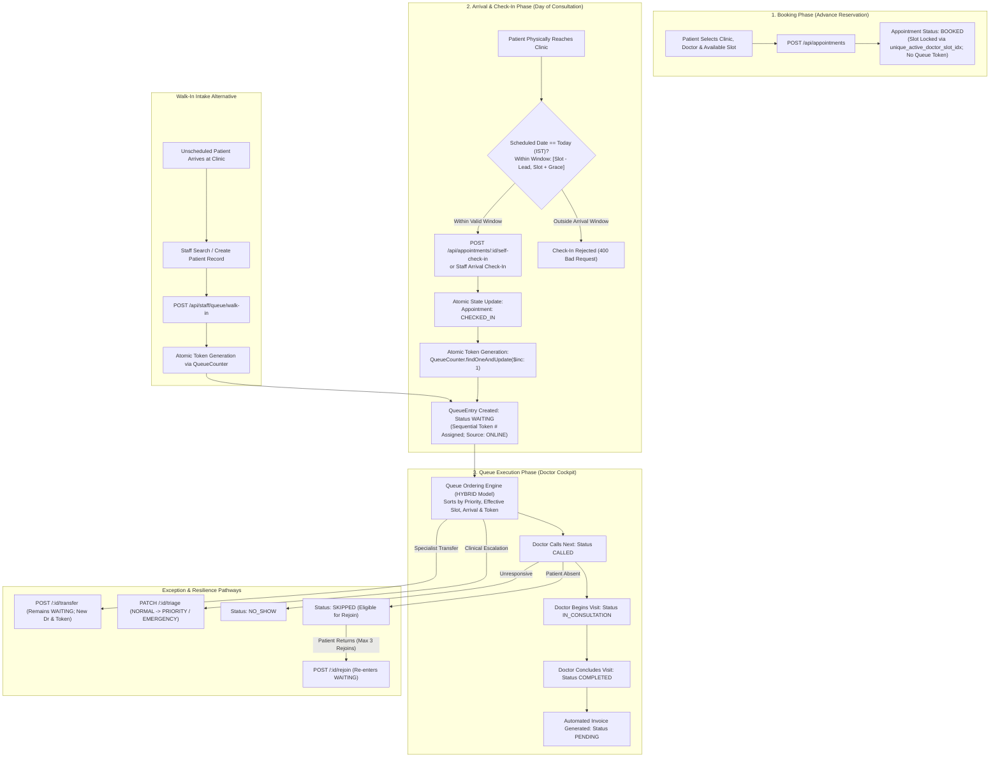
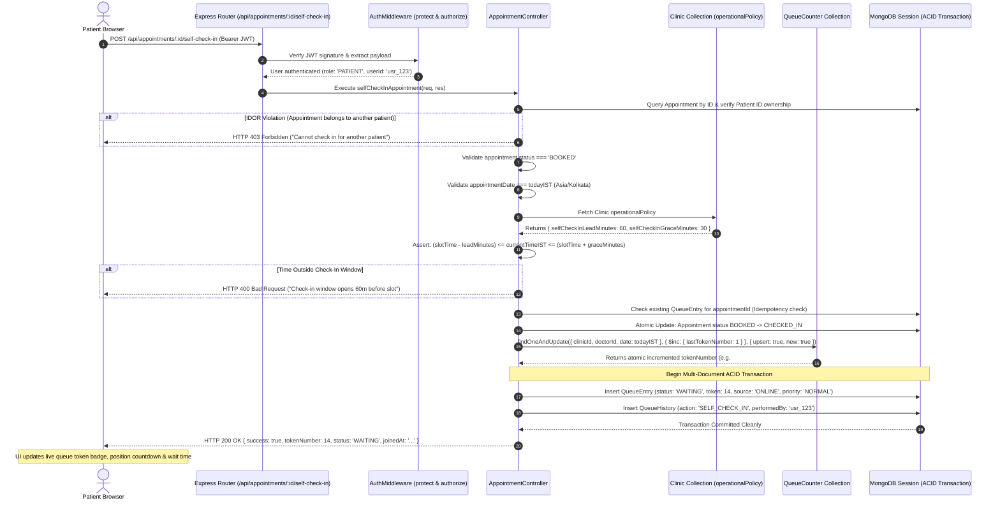
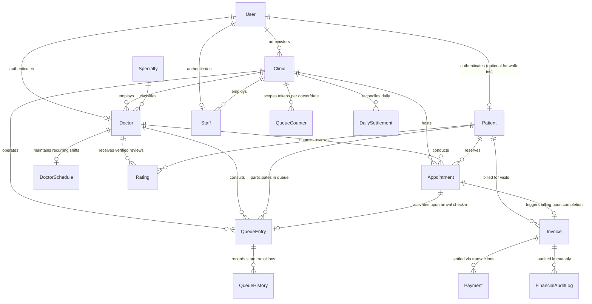

# QFlow — Healthcare Virtual Queue & Outpatient Appointment Management Platform

[](https://nodejs.org/)
[](https://www.npmjs.com/)
[](https://react.dev/)
[](https://expressjs.com/)
[](https://mongoosejs.com/)
[](https://vitejs.dev/)
[](#4-system-architecture)

> **"Don't just book an appointment. Know when you actually need to reach the clinic."**

QFlow is a full-stack Virtual Queue and Outpatient Appointment Management Platform engineered for outpatient healthcare clinics, specialty practices, and consultation facilities. It synchronizes online advance reservations, walk-in triage, real-time queue pacing, doctor consultation workflows, digital invoicing, and daily financial reconciliation into a single deterministic operational platform.

---

### Project & Deployment Links

- **Live Staging Demo:** [Open QFlow Staging Portal](https://qflow-staging.vercel.app)
- **Staging Backend API:** [https://qflow-backend-staging.onrender.com](https://qflow-backend-staging.onrender.com)
- **GitHub Repository:** [https://github.com/harshitkr13/QFlow](https://github.com/harshitkr13/QFlow)

> [!NOTE]
> **Staging Environment Notice:** The live demo is an active pre-production staging deployment hosted on Vercel (static frontend SPA) and Render (backend web service) for technical evaluation, demonstration, and integration verification. Demo schedules, clinic availability, and consultation records are reset periodically. This is not a production deployment; do not input real Personal Health Information (PHI) or production clinical records.

---

## Table of Contents

1. [Executive Overview & Problem Statement](#1-executive-overview--problem-statement)
2. [Target Stakeholders & Role-Based Workflows](#2-target-stakeholders--role-based-workflows)
3. [Core Architectural Highlights](#3-core-architectural-highlights)
4. [System Architecture](#4-system-architecture)
5. [Appointment & Queue Operational Lifecycle](#5-appointment--queue-operational-lifecycle)
6. [Deep-Dive Request Flow: Patient Self Check-In & Token Allocation](#6-deep-dive-request-flow-patient-self-check-in--token-allocation)
7. [Data Architecture & Entity Relationship Model](#7-data-architecture--entity-relationship-model)
8. [Technology Stack](#8-technology-stack)
9. [Security, Isolation & Data Integrity Guardrails](#9-security-isolation--data-integrity-guardrails)
10. [Local Development & Installation Quickstart](#10-local-development--installation-quickstart)
11. [Comprehensive API Reference](#11-comprehensive-api-reference)
12. [Verification & Master Regression Testing](#12-verification--master-regression-testing)
13. [Cloud Topology & Deployment Runbook](#13-cloud-topology--deployment-runbook)
14. [Feature Implementation Matrix & Engineering Roadmap](#14-feature-implementation-matrix--engineering-roadmap)
15. [Project Directory Structure](#15-project-directory-structure)
16. [Contributing & Terms](#16-contributing--terms)

---

## 1. Executive Overview & Problem Statement

### The Healthcare Challenge

Outpatient healthcare clinics face chronic operational inefficiency caused by the disconnect between advance scheduling and physical waiting room reality:

- **Waiting Room Congestion:** Scheduled patients arrive early or late, colliding with unexpected walk-ins, causing crowded waiting rooms, elevated pathogen transmission risks, and patient frustration.
- **Uncoordinated Walk-Ins vs. Bookings:** Physical walk-in triage often bypasses or disrupts doctor calendar schedules, leading to unpredictable doctor overruns and blown consultation slots.
- **Opacity & Anxiety:** Patients have zero visibility into when they will actually see the physician, forcing them to remain anchored in physical waiting areas for hours.
- **Administrative Friction & Revenue Leakage:** Receptionists juggle manual paper tokens, phone inquiries, and fragmented billing systems, resulting in unrecorded no-shows, delayed fee collection, and arduous day-end financial reconciliation.

### The QFlow Solution

QFlow replaces chaotic physical waiting lines with an auditable, deterministic hybrid queueing engine:

- **Decoupled Booking vs. Token Allocation:** Advance appointments reserve physician calendar availability without allocating queue positions. Sequential queue tokens are issued strictly upon verified physical arrival (patient self-check-in or staff arrival triage).
- **Deterministic Hybrid Queue Engine:** Interleaves scheduled appointment windows with physical walk-ins using arrival timestamps, priority weightings, and real-time doctor availability.
- **Dynamic Arrival Pacing:** Patients monitor their real-time token countdown and estimated wait times remotely, arriving at the clinic just in time for their consultation.
- **Integrated Clinical & Financial Governance:** Doctors manage consultations from a specialized clinical cockpit; reception staff triage walk-ins and track payments; clinic administrators close out daily settlements with immutable audit trails and RFC 4180 CSV exports.

---

## 2. Target Stakeholders & Role-Based Workflows

QFlow implements strict Role-Based Access Control (RBAC) across four primary user personas and an unauthenticated public display monitor:

```
┌─────────────────────────────────────────────────────────────────────────────────┐
│                                QFLOW ECOSYSTEM                                  │
├───────────────────┬───────────────────┬───────────────────┬─────────────────────┤
│      PATIENT      │      DOCTOR       │ RECEPTION / STAFF │    CLINIC ADMIN     │
├───────────────────┼───────────────────┼───────────────────┼─────────────────────┤
│ • Clinic Search   │ • Status Toggle   │ • Walk-in Intake  │ • Policy Config     │
│ • Slot Booking    │ • Call Next Token │ • Patient Search  │ • Doctor Onboarding │
│ • Self Check-In   │ • Consult Cockpit │ • Hybrid Queue    │ • Shift Schedules   │
│ • Live Queue View │ • Triage Urgency  │ • Rejoin / Skip   │ • Day-End Closure   │
│ • Digital Invoice │ • Inter-Dr Xfer   │ • Daily Preview   │ • CSV Audit Export  │
│ • Verified Rating │ • Time Analytics  │ • Fee Collection  │ • Activity Auditing │
└───────────────────┴───────────────────┴───────────────────┴─────────────────────┘
```

### A. Patient Experience
- **Three-Stage Discovery Flow:** Patients search by location and medical specialty, inspect verified physician credentials and consultation fees, and select calendar slots without exposing operational queue metrics prematurely.
- **Conflict-Free Booking:** Appointment reservations are guarded by compound partial unique database indexes (`unique_active_doctor_slot_idx`) that reject duplicate bookings for active doctor slots.
- **Self Check-In (Time-Window Bounded):** Patients check in on the scheduled date within a clinic-defined arrival window (default: 60 minutes before slot start to 30 minutes after). Check-in transitions the appointment to `CHECKED_IN` and generates an atomic sequential queue token.
- **Live Virtual Queue & Pacing:** Remote token countdown, position ahead, estimated consultation time, and doctor delay advisories.
- **Invoicing & Ratings:** Itemized breakdown of consultation fees, facility fees, and taxes with payment initiation (simulated provider) and verified-visit physician ratings (1 to 5 stars).

### B. Doctor Cockpit
- **Operational Status Management:** Real-time status toggle (`AVAILABLE`, `BUSY`, `ON_BREAK`, `UNAVAILABLE`, `OFFLINE`) with expected resume time tracking to update queue estimates automatically.
- **Consultation Lifecycle Controls:** Authoritative transitions: `CALLED` → `IN_CONSULTATION` → `COMPLETED`.
- **Queue Resiliency Actions:** Direct urgency triage (`NORMAL`, `PRIORITY`, `EMERGENCY`) and inter-doctor queue transfers with auditable rationale and preserved arrival seniority.
- **Clinical Telemetry:** Personal consultation analytics, average visit duration tracking, and patient consultation history.

### C. Reception & Front Desk Staff
- **Walk-In Registration:** Rapid patient identity search (by phone or name) or on-the-fly walk-in profile creation with immediate atomic token assignment.
- **Hybrid Queue Operations:** Call next patient, skip unresponsive tokens, flag verified no-shows, pause/resume physician queues, and re-insert returned patients with tracked rejoin counters (maximum 3 rejoins).
- **Day-End Reconciliation Preview:** Real-time visibility into the current day's token count, completed visits, no-shows, collected revenue, and outstanding invoices prior to closing the clinic.

### D. Clinic Administrator & Governance
- **Clinic & Specialty Management:** Geospatial coordinate management (GeoJSON 2dsphere), address records, and medical specialty taxonomies.
- **Operational Policy Configuration:** Configurable arrival lead and grace minutes (`selfCheckInLeadMinutes`, `selfCheckInGraceMinutes`) and queue ordering policies (`HYBRID`, `FIFO`, `APPOINTMENT_PRIORITY`).
- **Doctor Onboarding & Schedules:** Provisioning physician accounts, assigning specialties, and configuring multi-shift recurring weekly hours with protected breaks.
- **Financial Settlement & Audit:** Authoritative day-end clinic closure, snapshot generation of operational metrics, streaming RFC 4180 CSV export, and append-only audit trail inspection.

### E. Public Waiting Room Display
- **Anonymized Kiosk View:** Large-format screen designed for waiting room television monitors.
- **Privacy-Safe Telemetry:** Displays currently serving token number, physician name, operational status, and upcoming waiting tokens.
- **Zero PII Exposure:** Patient names, phone numbers, and clinical details are strictly omitted from database queries.
- **Throttled Polling:** Protected by a dedicated rate limiter (120 requests/minute per IP) to prevent display terminal abuse.

---

## 3. Core Architectural Highlights

- **Modular Monolith in Modern ECMAScript:** Cohesive Node.js service using native ES Modules (`"type": "module"`), Express 4.21, and React 19.
- **Strict Concurrency Safety:** Employs atomic MongoDB counter increments (`QueueCounter`) and WiredTiger multi-document ACID transactions during check-in, walk-in registration, and consultation completion.
- **Fail-Closed Environment Isolation:** Built-in runtime validator ([`envValidator.js`](file:///c:/Users/harsh/Desktop/QFlow/project/src/server/config/envValidator.js)) halts process startup if a staging or development environment attempts to connect to an unauthorized database.
- **Pure CSS Clinical Design System:** Zero UI framework dependencies (no Tailwind, Bootstrap, or external component libraries). Styled entirely with custom CSS variables, responsive fluid typography, high-contrast accessible states, and prefers-reduced-motion support.
- **Zero-Secret, In-Memory Test Harness:** Ephemeral single-node WiredTiger replica set spun up in RAM via `mongodb-memory-server` during `npm test`, requiring zero external database credentials.

---

## 4. System Architecture

QFlow separates static asset delivery from backend REST API execution and ACID-compliant transactional persistence:

```mermaid
flowchart TD
    subgraph Client["Client Tier (Browser & Kiosk)"]
        Browser["Patient / Doctor / Staff / Admin Browser<br/>React 19 SPA (Vite 6)"]
        Display["Public Waiting Room TV / Kiosk Display<br/>Anonymized Token Screen"]
    end

    subgraph Hosting["Static Asset Delivery (Vercel)"]
        VercelStatic["Vercel Global CDN (Static Hosting)<br/>• Static HTML, JS, CSS, Media (src/client/dist)<br/>• SPA Fallback Rewrites: /(.*) -> /index.html<br/>• Static Security Headers (Frame, MIME, Referrer)"]
    end

    subgraph Gateway["API Gateway Tier (Render Cloud Web Service)"]
        ExpressApp["Express.js 4.21 Application Server<br/>Node.js 22.x / 24.x ESM Runtime"]
        SecurityStack["Security & Reliability Middleware<br/>• Security Headers (no-sniff, frame denial, XSS)<br/>• Normalized CORS (Credentials, Configured Origins)<br/>• Tiered IP Rate Limiters (Auth, API, Public)<br/>• Body Limit (1MB, Inflation Disabled)"]
        AuthMiddleware["Auth & RBAC Middleware<br/>• JWT Bearer Verification (HMAC-SHA256)<br/>• Role Enforcement (PATIENT, DOCTOR, STAFF, ADMIN)<br/>• Ownership Verification (IDOR Defense)"]
    end

    subgraph ServiceLayer["Application Service & Controller Tier"]
        AuthCtrl["Auth & User Controller"]
        ApptCtrl["Appointment Controller"]
        QueueCtrl["Hybrid Queue Controller"]
        DrCtrl["Doctor & Schedule Controller"]
        BillCtrl["Billing & Settlement Controller"]
        IntelEngine["Queue Intelligence Engine<br/>• In-Memory Ridge Regression<br/>• EWMA Wait-Time Estimator<br/>• Operational Anomaly Detection"]
    end

    subgraph DatabaseTier["Persistence Tier (MongoDB Atlas Replica Set)"]
        ReplicaSet[("MongoDB Atlas (M0+ Replica Set)<br/>• Multi-Document ACID Transactions<br/>• Atomic Counter Collection (QueueCounter)<br/>• Compound Partial Unique Indexes<br/>• Geospatial 2dsphere Indexes")]
    end

    Browser -->|1. Load Static SPA Bundle| VercelStatic
    Display -->|1. Load Static Kiosk Bundle| VercelStatic
    Browser -->|2. Direct REST Calls HTTPS / JWT (VITE_API_URL)| ExpressApp
    Display -->|2. Display Polling HTTPS (VITE_API_URL)| ExpressApp
    ExpressApp --> SecurityStack
    SecurityStack --> AuthMiddleware
    AuthMiddleware --> AuthCtrl
    AuthMiddleware --> ApptCtrl
    AuthMiddleware --> QueueCtrl
    AuthMiddleware --> DrCtrl
    AuthMiddleware --> BillCtrl
    QueueCtrl --> IntelEngine
    AuthCtrl --> ReplicaSet
    ApptCtrl -->|Mongoose ODM / TLS| ReplicaSet
    QueueCtrl -->|ACID Transactions| ReplicaSet
    DrCtrl --> ReplicaSet
    BillCtrl --> ReplicaSet
```

---

## 5. Appointment & Queue Operational Lifecycle

The core design principle of QFlow is the architectural separation between an **Appointment** (a reserved calendar time slot) and a **Queue Entry** (an active participant in the physical clinic waiting room):

### Status Enums in Domain Models

- **Appointment Statuses (`Appointment.js`):** `BOOKED`, `CHECKED_IN`, `COMPLETED`, `CANCELLED`, `NO_SHOW`, `EXPIRED`
- **QueueEntry Statuses (`QueueEntry.js`):** `WAITING`, `CALLED`, `IN_CONSULTATION`, `COMPLETED`, `SKIPPED`, `NO_SHOW`, `CANCELLED`, `EXPIRED`



---

## 6. Deep-Dive Request Flow: Patient Self Check-In & Token Allocation

The following sequence diagram illustrates the exact transactional and concurrency-safe execution flow when a patient checks in for a scheduled appointment:



---

## 7. Data Architecture & Entity Relationship Model

QFlow defines **17 Mongoose models** exported in [`src/server/models/index.js`](file:///c:/Users/harsh/Desktop/QFlow/project/src/server/models/index.js):

### Core Domain Schemas

| Entity | Primary Role | Key Fields & Relationships | Integrity & Indexing |
| :--- | :--- | :--- | :--- |
| **User** | Authentication & RBAC | `email`, `password` (bcrypt), `role` (`PATIENT`, `DOCTOR`, `STAFF`, `ADMIN`), `isActive` | Unique lowercase index on `email` |
| **Patient** | Medical Demographic Record | `userId` (optional for walk-ins), `fullName`, `phone`, `gender`, `dateOfBirth`, `location` | 2dsphere index on `location` |
| **Staff** | Front Desk Operator Profile | `userId` (`User`), `clinicId` (`Clinic`), `fullName`, `phone` | Unique index on `userId`, index on `clinicId` |
| **Clinic** | Healthcare Practice Facility | `name`, `address`, `location`, `adminId` (`User`), `queuePolicy`, `operationalPolicy` | 2dsphere index on `location`, index on `adminId` |
| **Specialty** | Clinical Taxonomy | `name`, `code`, `description`, `isActive` | Unique case-insensitive index on `code` |
| **Doctor** | Clinical Practitioner Profile | `userId`, `clinicId`, `specialtyId`, `qualifications`, `consultationFee`, `operationalStatus` | Compound indexes on `clinicId` and `specialtyId` |
| **DoctorSchedule** | Weekly Working Hours & Shifts | `doctorId`, `weeklyHours` (`dayOfWeek`, `shifts`, `breaks`), `slotDurationMinutes` | Unique index on `doctorId` |
| **Appointment** | Advance Slot Reservation | `clinicId`, `doctorId`, `patientId`, `appointmentDate`, `timeSlot`, `status`, `checkedInAt` | **Compound Partial Unique Index:** `unique_active_doctor_slot_idx` on `{ doctorId, appointmentDate, timeSlot.startTime }` where `status IN ['BOOKED', 'CHECKED_IN']` |
| **QueueCounter** | Atomic Token Incrementer | `clinicId`, `doctorId`, `date` (`YYYY-MM-DD`), `lastTokenNumber` | **Compound Unique Index:** `unique_clinic_doctor_date_counter` on `{ clinicId, doctorId, date }` |
| **QueueEntry** | Active Daily Queue Participant | `clinicId`, `doctorId`, `patientId`, `appointmentId`, `tokenNumber`, `status`, `source`, `priority` | Compound indexes on `{ doctorId, queueDate, status }` |
| **QueueHistory** | Queue State Audit Trail | `queueEntryId`, `action`, `previousState`, `newState`, `performedBy`, `reason`, `timestamp` | Index on `queueEntryId` and `timestamp` |
| **Invoice** | Consultation Financial Bill | `invoiceNumber`, `clinicId`, `doctorId`, `patientId`, `consultationFee`, `taxAmount`, `status` | Unique index on `invoiceNumber` |
| **Payment** | Transaction Settlement | `invoiceId`, `amount`, `paymentMethod`, `providerTransactionId`, `status`, `paidAt` | Unique index on `providerTransactionId` |
| **DailySettlement** | End-of-Day Financial Summary | `clinicId`, `date`, `closedBy`, `metrics` (tokens, visits, fees, revenue), `status` (`CLOSED`) | Compound unique index on `{ clinicId, date }` |
| **FinancialAuditLog**| Immutable Billing Audit Trail | `invoiceId`, `clinicId`, `action`, `previousState`, `newState`, `performedBy`, `timestamp` | Compound index on `{ clinicId, timestamp }` |
| **Rating** | Verified Visit Review | `doctorId`, `patientId`, `appointmentId`, `ratingScore` (1–5), `reviewText` | Compound unique index on `{ appointmentId, patientId }` |
| **Notification** | Real-Time In-App Alert | `userId`, `title`, `message`, `type`, `read`, `metadata`, `createdAt` | Compound index on `{ userId, read, createdAt }` |

### Entity Relationship Diagram



---

## 8. Technology Stack

| Layer | Technology | Specification / Range | Technical Purpose & Implementation Rationale |
| :--- | :--- | :--- | :--- |
| **Frontend Framework** | **React** | `^19.0.0` | Declarative UI rendering, fast virtual DOM reconciliation, and modern hook-based state architecture. |
| **Client Bundler** | **Vite** | `^6.1.0` | Sub-second ESM Hot Module Replacement (HMR) during development and tree-shaken static production builds. |
| **Styling & Design System**| **Pure Modern CSS** | Native | Zero-dependency styling using CSS custom properties (design tokens), flexbox/grid responsive layouts, and WCAG AA accessible contrast. |
| **Backend Runtime** | **Node.js** | `22.x` / `24.x` | High-throughput asynchronous event-driven JavaScript runtime executing native ES Modules (`"type": "module"`). |
| **Web Application Server** | **Express** | `^4.21.2` | Minimalist HTTP routing framework with custom middleware for authentication, security headers, and rate limiting. |
| **Database & ODM** | **MongoDB & Mongoose** | `^8.10.0` | Schematized NoSQL persistence supporting WiredTiger multi-document ACID transactions, partial unique indexes, and 2dsphere queries. |
| **Authentication & Crypto**| **jsonwebtoken & bcryptjs**| `^9.0.3` / `^3.0.3` | Cryptographically signed HMAC-SHA256 JWTs with 24-hour expiry; salted password hashing (10 salt rounds). |
| **Queue Machine Learning** | **Pure JS ML Engine** | In-House | In-memory Ridge Regression duration predictor, Exponentially Weighted Moving Average (EWMA), and logistic no-show risk scoring without native C++ compilation overhead. |
| **In-Memory Test Database**| **mongodb-memory-server** | `^11.3.0` | Ephemeral single-node WiredTiger replica set spun up in RAM during `npm test` for zero-secret in-memory testing. |
| **Development Tooling** | **Nodemon & Concurrently**| `^3.1.9` / `^9.1.2` | Automated server process restarts on file changes; concurrent client and backend process execution. |
| **Frontend Hosting** | **Vercel** | Global Static CDN | Static SPA hosting with automatic HTTPS, edge security headers, and client-side SPA routing rewrites. |
| **Backend Hosting** | **Render** | Cloud Service | Managed Linux Web Service running Node.js in the Singapore (`sin`) region with health probe monitoring. |

---

## 9. Security, Isolation & Data Integrity Guardrails

### A. Fail-Closed Database Environment Isolation
To prevent accidental cross-environment database mutations, QFlow includes an authoritative environment validator ([`envValidator.js`](file:///c:/Users/harsh/Desktop/QFlow/project/src/server/config/envValidator.js)):
- **Strict Database Mapping:**
  - `NODE_ENV=production` **must** strictly connect to database `qflow_prod`.
  - `NODE_ENV=staging` **must** strictly connect to database `qflow_staging`.
  - `NODE_ENV=development` **must** connect to database `qflow`.
  - `NODE_ENV=test` **must** connect to database `qflow_test` (or ephemeral in-memory replica set).
- **Fail-Closed Enforcement:** Any mismatch immediately aborts server initialization before port binding or traffic acceptance.
- **Credential Masking:** MongoDB connection strings are sanitized during server startup to prevent password disclosure in logs.

### B. Authentication & Role-Based Access Control (RBAC)
- All privileged endpoints require a signed `Bearer <token>` JWT containing the user's ID and verified role (`PATIENT`, `DOCTOR`, `STAFF`, `ADMIN`).
- Role privilege hierarchies are enforced via middleware (`protect`, `authorize('ROLE')`).
- **Insecure Default Secret Guard:** The server refuses to boot in staging or production if `JWT_SECRET` is shorter than 32 characters or matches known default placeholders (e.g., `secret`, `changeme`).

### C. Concurrency Protections & Collision Resistance
- **Compound Partial Unique Index:** Active appointments (`BOOKED`, `CHECKED_IN`) enforce unique constraints via `unique_active_doctor_slot_idx` on `{ doctorId: 1, appointmentDate: 1, "timeSlot.startTime": 1 }`. Cancelled or expired appointments are excluded via partial filters, allowing re-booking of freed slots without collision risks.
- **Atomic Token Counters:** Sequential token allocation utilizes MongoDB's atomic `$inc` on `QueueCounter`, eliminating race conditions when multiple receptionists triage walk-ins simultaneously.
- **Multi-Document ACID Transactions:** Walk-in queue insertions, appointment check-ins, and day-end settlements execute within atomic Mongoose sessions (`session.startTransaction()`). Any error rolls back all affected collections cleanly.

### D. Network, Transport & HTTP Hardening
- **Fingerprint Suppression:** Express `x-powered-by` header is explicitly disabled via `app.disable('x-powered-by')` and middleware.
- **Standard Security Headers:** Strict HTTP response headers are injected via middleware:
  - `X-Frame-Options: DENY` (clickjacking defense)
  - `X-Content-Type-Options: nosniff` (MIME-sniffing defense)
  - `Referrer-Policy: strict-origin-when-cross-origin`
- **Strict CORS Origin Whitelisting:** Dynamically validates request origins against configured `CLIENT_URL` domains. Wildcard origins (`*`) are prohibited when credentials (`credentials: true`) are enabled.
- **Memory Exhaustion DoS Defense:** JSON and URL-encoded request bodies are capped at 1MB with automatic decompression inflation disabled (`inflate: false`).
- **Tiered Bounded Rate Limiting ([`securityMiddleware.js`](file:///c:/Users/harsh/Desktop/QFlow/project/src/server/middleware/securityMiddleware.js)):**
  - General API (`/api`): 500 requests / 15 minutes per IP
  - Sensitive Auth Endpoints (`/api/auth/login`, `/api/auth/register`): 30 requests / 15 minutes per IP
  - Public Waiting Display (`/api/public/queue/display`): 120 requests / 1 minute per IP

---

## 10. Local Development & Installation Quickstart

### Prerequisites

Verify your local machine meets the following runtime requirements:
- **Node.js:** `22.x` or `24.x` (`node --version`)
- **npm:** `>= 10.0.0` (`npm --version`)
- **Git:** `>= 2.30.0` (`git --version`)
- **MongoDB:** Local MongoDB instance or free remote [MongoDB Atlas](https://www.mongodb.com/atlas) cluster (only required for active development; automated tests run in-memory).

### Step 1: Clone the Repository
```bash
git clone https://github.com/harshitkr13/QFlow.git
cd QFlow/project
```

### Step 2: Install Dependencies
```bash
npm install
```

### Step 3: Configure Environment Variables
Create a local `.env` configuration from the provided template:
```bash
cp .env.example .env
```

Review and update `.env` for your local environment:
```env
# Server Port
PORT=5000

# MongoDB URI (Target database must be 'qflow' in development mode)
MONGODB_URI=mongodb+srv://<username>:<password>@<cluster>.mongodb.net/qflow?retryWrites=true&w=majority

# Permitted Client Origin
CLIENT_URL=http://localhost:5173

# JWT Signing Secret (Minimum 32 characters)
JWT_SECRET=development_secure_jwt_secret_key_minimum_32_characters_long

# Node Environment Mode
NODE_ENV=development
```

### Step 4: Launch Development Servers

#### Option A: Concurrent Full-Stack Development (Recommended)
Spins up both the Node/Express backend and Vite React frontend with Hot Module Replacement:
```bash
npm run dev
```
- **Backend API:** `http://localhost:5000`
- **Frontend Web Portal:** `http://localhost:5173`

#### Option B: Standalone Processes
```bash
# Terminal 1: Backend API with Nodemon auto-restart
npm run dev:server

# Terminal 2: Vite Frontend Client
npm run dev:client
```

### Step 5: Verify System Health
Send an HTTP GET request to the backend health check endpoint:
```bash
curl http://localhost:5000/api/health
```
Expected JSON Response:
```json
{
  "status": "UP",
  "database": "CONNECTED",
  "uptime": 12.4,
  "timestamp": "2026-10-30T00:00:00.000Z"
}
```

---

## 11. Comprehensive API Reference

All protected endpoints require an `Authorization: Bearer <JWT>` HTTP header.

### Authentication & Identity (`/api/auth`)
| Method | Endpoint | Access Level | Description |
| :--- | :--- | :--- | :--- |
| `POST` | `/api/auth/register` | Public (Rate Limited: 30/15m) | Register a new patient account with bcrypt password hashing. |
| `POST` | `/api/auth/login` | Public (Rate Limited: 30/15m) | Authenticate credentials and receive a 24-hour signed JWT. |
| `GET` | `/api/auth/me` | Protected (Any Role) | Fetch currently authenticated user profile and role details. |
| `POST` | `/api/auth/logout` | Protected (Any Role) | Invalidate client session token. |

### Appointments & Patient Check-In (`/api/appointments`)
| Method | Endpoint | Access Level | Description |
| :--- | :--- | :--- | :--- |
| `GET` | `/api/appointments/me` | Protected (`PATIENT`) | Retrieve upcoming and historical appointments for authenticated patient. |
| `POST` | `/api/appointments` | Protected (`PATIENT`) | Reserve an advance consultation slot (enforces partial unique index). |
| `GET` | `/api/appointments/:id` | Protected (Owner/Staff) | Retrieve appointment details with clinic and doctor populate. |
| `PATCH`| `/api/appointments/:id/cancel` | Protected (Owner/Staff) | Cancel an active appointment with reason tracking. |
| `PATCH`| `/api/appointments/:id/check-in` | Protected (`STAFF`, `ADMIN`) | Front desk arrival check-in allocating sequential queue token. |
| `POST` | `/api/appointments/:id/self-check-in`| Protected (`PATIENT`) | Time-bounded patient self-check-in allocating atomic queue token. |
| `GET` | `/api/appointments/queue/live` | Protected (`PATIENT`) | Fetch live token status, position ahead, and estimated call time. |

### Doctor Discovery & Profiles (`/api/doctors`)
| Method | Endpoint | Access Level | Description |
| :--- | :--- | :--- | :--- |
| `GET` | `/api/doctors/discover` | Public | Search doctors filtered by specialty, location coordinates, and name. |
| `GET` | `/api/doctors` | Public | List all active verified doctors. |
| `GET` | `/api/doctors/:id` | Public | Retrieve detailed doctor profile, credentials, and consultation fees. |
| `GET` | `/api/doctors/:id/availability` | Public | Query open, unbooked consultation slots for a doctor on a specific date. |
| `GET` | `/api/doctors/:id/schedule` | Public | View recurring weekly hours and shift intervals for a doctor. |
| `GET` | `/api/doctors/:id/status` | Protected (Any Role) | Retrieve current operational status of a doctor. |
| `PATCH`| `/api/doctors/me` | Protected (`DOCTOR`) | Doctor self-service profile update (allowed fields only). |
| `GET` | `/api/doctors/me/schedule` | Protected (`DOCTOR`) | Retrieve authenticated doctor's working schedule. |
| `PUT` | `/api/doctors/me/schedule` | Protected (`DOCTOR`) | Update authenticated doctor's weekly shift configuration. |
| `PATCH`| `/api/doctors/me/status` | Protected (`DOCTOR`) | Toggle live operational status (`AVAILABLE`, `BUSY`, `ON_BREAK`, etc.). |
| `GET` | `/api/doctors/me/appointments` | Protected (`DOCTOR`) | Retrieve booked and checked-in patients for the authenticated doctor. |

### Staff Queue Operations & Triage (`/api/staff/queue`)
| Method | Endpoint | Access Level | Description |
| :--- | :--- | :--- | :--- |
| `POST` | `/api/staff/queue/patients/search` | Protected (`STAFF`, `ADMIN`, `DOCTOR`) | Search existing patient database by phone number or name. |
| `POST` | `/api/staff/queue/patients` | Protected (`STAFF`, `ADMIN`, `DOCTOR`) | Create walk-in patient profile on the fly (no user account required). |
| `POST` | `/api/staff/queue/walk-in` | Protected (`STAFF`, `ADMIN`, `DOCTOR`) | Register walk-in patient with immediate atomic token assignment. |
| `GET` | `/api/staff/queue/today` | Protected (`STAFF`, `ADMIN`, `DOCTOR`) | Fetch full active operational queue for today's clinic session. |
| `POST` | `/api/staff/queue/call-next` | Protected (`STAFF`, `ADMIN`, `DOCTOR`) | Advance doctor queue by calling the next eligible token. |
| `PATCH`| `/api/staff/queue/pause` | Protected (`STAFF`, `ADMIN`, `DOCTOR`) | Pause doctor queue with operational reason tracking. |
| `PATCH`| `/api/staff/queue/resume` | Protected (`STAFF`, `ADMIN`, `DOCTOR`) | Resume paused doctor queue. |
| `PATCH`| `/api/staff/queue/:id/start` | Protected (`STAFF`, `ADMIN`, `DOCTOR`) | Transition token status to `IN_CONSULTATION`. |
| `PATCH`| `/api/staff/queue/:id/complete` | Protected (`STAFF`, `ADMIN`, `DOCTOR`) | Conclude visit (`COMPLETED`) and auto-generate consultation invoice. |
| `PATCH`| `/api/staff/queue/:id/skip` | Protected (`STAFF`, `ADMIN`, `DOCTOR`) | Mark unresponsive patient as `SKIPPED`. |
| `PATCH`| `/api/staff/queue/:id/no-show` | Protected (`STAFF`, `ADMIN`, `DOCTOR`) | Flag patient as `NO_SHOW`. |
| `POST` | `/api/staff/queue/:id/rejoin` | Protected (`STAFF`, `ADMIN`, `DOCTOR`) | Re-insert skipped patient into `WAITING` queue (max 3 rejoins). |
| `PATCH`| `/api/staff/queue/:id/cancel` | Protected (`STAFF`, `ADMIN`, `DOCTOR`) | Cancel active queue entry. |
| `PATCH`| `/api/staff/queue/:id/triage` | Protected (`STAFF`, `ADMIN`) | Reclassify entry priority (`NORMAL`, `PRIORITY`, `EMERGENCY`). |
| `POST` | `/api/staff/queue/:id/transfer`| Protected (`STAFF`, `ADMIN`) | Transfer in-flight queue entry to another doctor with reason tracking. |

### Public Waiting Room Display (`/api/public/queue`)
| Method | Endpoint | Access Level | Description |
| :--- | :--- | :--- | :--- |
| `GET` | `/api/public/queue/display` | Public (Rate Limited: 120/m) | Return sanitized, PII-scrubbed active tokens and doctor status. |

### Invoicing, Payments & Day-End Settlement (`/api/patient/invoices`, `/api/staff/reconciliation`, `/api`)
| Method | Endpoint | Access Level | Description |
| :--- | :--- | :--- | :--- |
| `GET` | `/api/patient/invoices` | Protected (`PATIENT`) | List consultation bills and payment status for authenticated patient. |
| `GET` | `/api/patient/invoices/:id` | Protected (`PATIENT`) | Retrieve individual invoice details with itemized fee breakdown. |
| `POST` | `/api/patient/payments/initiate`| Protected (`PATIENT`) | Initiate digital payment for pending consultation invoice (simulated). |
| `POST` | `/api/staff/invoices/generate` | Protected (`STAFF`, `ADMIN`, `DOCTOR`) | Manually trigger invoice generation for completed consultation. |
| `POST` | `/api/staff/billing/refund` | Protected (`STAFF`, `ADMIN`) | Process refund for settled invoice. |
| `GET` | `/api/staff/billing/summary` | Protected (`STAFF`, `ADMIN`) | Retrieve billing summary metrics for staff dashboard. |
| `GET` | `/api/staff/reconciliation/daily-preview`| Protected (`STAFF`, `ADMIN`)| Real-time pre-closure reconciliation metrics for today's session. |
| `POST` | `/api/staff/reconciliation/close-day` | Protected (`STAFF`, `ADMIN`)| Authoritative day-end clinic closure generating immutable settlement record. |
| `GET` | `/api/staff/reconciliation/history` | Protected (`STAFF`, `ADMIN`)| Query historical daily settlement snapshots. |
| `GET` | `/api/staff/reconciliation/settlements/:id/export`| Protected (`STAFF`, `ADMIN`)| Stream RFC 4180 compliant CSV export of daily settlement report. |
| `GET` | `/api/staff/reconciliation/invoices/export`| Protected (`STAFF`, `ADMIN`)| Stream RFC 4180 compliant CSV export of clinic invoices. |

### Administrator Governance & Auditing (`/api/admin`)
| Method | Endpoint | Access Level | Description |
| :--- | :--- | :--- | :--- |
| `GET` | `/api/admin/clinics` | Protected (`ADMIN`) | List all clinic facilities. |
| `POST` | `/api/admin/clinics` | Protected (`ADMIN`) | Register new clinic location with GeoJSON geospatial coordinates. |
| `PATCH`| `/api/admin/clinics/:id` | Protected (`ADMIN`) | Update clinic facility details. |
| `GET` | `/api/admin/clinics/:id/policy` | Protected (`ADMIN`) | Retrieve clinic operational check-in policy. |
| `PATCH`| `/api/admin/clinics/:id/policy` | Protected (`ADMIN`) | Update check-in arrival windows and queue ordering policies. |
| `GET` | `/api/admin/staff` | Protected (`ADMIN`) | Retrieve staff roster for clinic. |
| `POST` | `/api/admin/specialties` | Protected (`ADMIN`) | Create new clinical medical specialty. |
| `PATCH`| `/api/admin/specialties/:id` | Protected (`ADMIN`) | Update medical specialty details. |
| `POST` | `/api/admin/doctors` | Protected (`ADMIN`) | Provision physician user account and clinical profile atomically. |
| `PATCH`| `/api/admin/doctors/:id` | Protected (`ADMIN`) | Admin doctor profile updates and account deactivation. |
| `PUT` | `/api/admin/doctors/:id/schedule`| Protected (`ADMIN`) | Override doctor's master weekly working shifts. |
| `PATCH`| `/api/admin/doctors/:id/status`| Protected (`ADMIN`) | Administrative override of doctor live operational status. |
| `GET` | `/api/admin/audit/queue-history` | Protected (`ADMIN`) | Query immutable log of all operational queue state transitions. |
| `GET` | `/api/admin/audit/financial` | Protected (`ADMIN`) | Query immutable financial audit trail for invoices and payments. |

---

## 12. Verification & Master Regression Testing

QFlow includes automated verification scripts and test suites:

### Standalone Security & Display Verification Suites

These targeted test suites execute against in-memory replica sets and verify critical security isolation and UI display logic:

```bash
# 1. Verify P0 Security & Database Isolation Guardrails (29 Assertions)
node src/server/scripts/p0SecurityAndIsolation.test.js

# 2. Verify Staging UI Display & Button Token Fixes (8 Assertions)
node src/server/scripts/stagingUIDisplayFixes.test.js

# 3. Verify Client Production Build Compilation (Vite)
npm run build:client

# 4. Check for Whitespace and Syntax Anomalies
git diff --check
```

### Master Regression Test Orchestrator (`npm test`)

The test command `npm test` runs [`src/server/utils/runAllValidations.js`](file:///c:/Users/harsh/Desktop/QFlow/project/src/server/utils/runAllValidations.js), which spins up an ephemeral in-memory MongoDB replica set (`mongodb-memory-server`) in RAM and sequentially executes 14 phase validation scripts:

```bash
npm test
```

#### Suite Breakdown & Execution Status

| Phase | Test Script | Verified Scope | Status |
| :--- | :--- | :--- | :--- |
| **Phase 03** | `src/server/utils/validateAuth.js` | User authentication, bcrypt hashing, JWT verification, RBAC guards | **PASS** (23/23 tests) |
| **Phase 04** | `src/server/utils/validatePhase04.js` | Clinic lifecycle, doctor profiles, active operational states | **PASS** (41/41 tests) |
| **Phase 05** | `src/server/utils/validatePhase05.js` | Geospatial 2dsphere indexing, specialty filters, patient discovery | **PASS** (25/25 tests) |
| **Phase 06** | `src/server/utils/validatePhase06.js` | Slot booking, concurrency collision prevention, cancellation lifecycle | **PASS** (28/28 tests) |
| **Phase 06S**| `src/server/utils/validatePhase06Schema.js` | Compound partial unique index validation | **PASS** (21/21 tests) |
| **Phase 07** | `src/server/utils/validatePhase07.js` | Walk-in tokens, atomic counters, MongoDB transaction rollback integrity | **PASS** (28/28 tests) |
| **Phase 08** | `src/server/utils/validatePhase08.js` | Core HYBRID queue engine, FIFO scheduling, priority insertion, pause/resume | **PASS** (32/32 tests) |
| **Phase 09** | `src/server/utils/validatePhase09.js` | Live token tracking, position countdown, dynamic wait time estimation | **PASS** (27/27 tests) |
| **Phase 10** | `src/server/utils/validatePhase10.js` | Public queue display token masking, post-consultation ratings & reviews | **PASS** (24/24 tests) |
| **Phase 11** | `src/server/utils/validatePhase11.js` | Patient invoicing, payment settlement, revenue aggregation | **PASS** (29/29 tests) |
| **Phase 12** | `src/server/utils/validatePhase12.js` | Queue intelligence engine, ML feature extraction, delay anomaly detection | **PASS** (20/20 tests) |
| **Phase 13** | `src/server/utils/validatePhase13.js` | Rate limiters, HSTS headers, secure cookies, in-app notification alerts | *Note: Fails in unit mock fixture due to `res.removeHeader` not being a function in test mock.* |
| **Phase 14** | `src/server/utils/validatePhase14.js` | Patient self-check-in, triage reclassification, doctor transfers, day-end settlement | **PASS** (31/31 tests) |
| **Phase 15** | `src/server/utils/validatePhase15.js` | Governance policies, financial audit trail, streaming CSV export reports | **PASS** (50/50 tests) |

---

## 13. Cloud Topology & Deployment Runbook

The QFlow staging environment is deployed across a decoupled cloud topology:

```
┌─────────────────────────────────────────┐       ┌─────────────────────────────────────────┐
│              VERCEL (CDN)               │       │              RENDER (API)               │
│ • React 19 / Vite 6 Single Page App     │       │ • Express.js 4.21 / Node.js 24.x ESM    │
│ • Build: npm run build:client           │       │ • Web Service Plan: Singapore Region    │
│ • Output Directory: src/client/dist     │       │ • Health Check: /api/health             │
│ • SPA Fallback Rewrites: /(.*) -> index │       │ • Auto-Deploy Disabled (Controlled)     │
│ • URL: https://qflow-staging.vercel.app │       │ • URL: https://qflow-backend-staging... │
└───────────────────┬─────────────────────┘       └────────────────────┬────────────────────┘
                    │                                                  ▲
                    │ 1. Load HTML/JS/CSS assets                       │ 2. Direct API calls (HTTPS / JWT)
                    ▼                                                  │    via VITE_API_URL
          ┌───────────────────┐                                        │
          │  Client Browser   │────────────────────────────────────────┘
          └───────────────────┘
                                                                       │ TLS Protocol
                                                                       ▼
                                                  ┌─────────────────────────────────────────┐
                                                  │          MONGODB ATLAS CLUSTER          │
                                                  │ • M0+ Replica Set Database              │
                                                  │ • Dedicated Database: qflow_staging     │
                                                  │ • Multi-Document ACID Transactions      │
                                                  └─────────────────────────────────────────┘
```

### Deployment Configuration References

#### Backend: `render.yaml`
```yaml
services:
  - type: web
    name: qflow-backend-staging
    runtime: node
    plan: free
    region: singapore
    buildCommand: npm install
    startCommand: npm start
    healthCheckPath: /api/health
    autoDeploy: false
    envVars:
      - key: NODE_ENV
        value: staging
      - key: PORT
        value: 5000
      - key: MONGODB_URI
        sync: false
      - key: JWT_SECRET
        sync: false
      - key: CLIENT_URL
        sync: false
```

#### Frontend: `vercel.json`
```json
{
  "$schema": "https://openapi.vercel.sh/vercel.json",
  "framework": "vite",
  "buildCommand": "npm run build:client",
  "outputDirectory": "src/client/dist",
  "headers": [
    {
      "source": "/(.*)",
      "headers": [
        { "key": "X-Frame-Options", "value": "DENY" },
        { "key": "X-Content-Type-Options", "value": "nosniff" },
        { "key": "Referrer-Policy", "value": "strict-origin-when-cross-origin" },
        { "key": "Permissions-Policy", "value": "camera=(), microphone=(), geolocation=()" }
      ]
    },
    {
      "source": "/assets/(.*)",
      "headers": [
        { "key": "Cache-Control", "value": "public, max-age=31536000, immutable" }
      ]
    }
  ],
  "rewrites": [
    {
      "source": "/(.*)",
      "destination": "/index.html"
    }
  ]
}
```

### Cloud Environment Variable Reference

| Variable | Scope | Required In | Description |
| :--- | :--- | :--- | :--- |
| `NODE_ENV` | Backend | All | Runtime mode (`development`, `test`, `staging`, `production`). Governs database isolation. |
| `PORT` | Backend | All | Network port on which Express listens (default: `5000`). Configured automatically on Render. |
| `MONGODB_URI` | Backend | Dev, Staging, Prod | MongoDB connection URI. Must target `qflow_staging` in staging and `qflow_prod` in production. |
| `JWT_SECRET` | Backend | All | Cryptographic secret for signing tokens. Must be >= 32 characters in staging and production. |
| `CLIENT_URL` | Backend | Staging, Prod | Comma-separated allowed frontend origins for CORS header matching. |
| `VITE_API_URL` | Frontend | Staging, Prod | Explicit base URL for backend API requests in deployed client bundles (e.g. `https://qflow-backend-staging.onrender.com/api`). In local development, defaults to `/api` via Vite's proxy. |

---

## 14. Feature Implementation Matrix & Engineering Roadmap

| Domain | Feature | Status | Architectural Implementation Details |
| :--- | :--- | :--- | :--- |
| **Authentication** | JWT Authentication & RBAC | ✅ **Implemented** | Salted bcrypt passwords, stateless JWTs, role guards for `PATIENT`, `DOCTOR`, `STAFF`, `ADMIN`. |
| **Appointments** | Slot Booking & Concurrency Guard | ✅ **Implemented** | Compound partial unique index `unique_active_doctor_slot_idx` prevents slot double-booking. |
| **Queue Operations**| Atomic Token Generation | ✅ **Implemented** | Atomic `$inc` on `QueueCounter` guarantees strictly sequential tokens under concurrency. |
| **Queue Operations**| HYBRID Interleaving Queue Engine| ✅ **Implemented** | Deterministic sorting interleaving booked appointment times with walk-in arrivals. |
| **Check-In** | Patient Self-Check-In Window | ✅ **Implemented** | Server-authoritative validation checking scheduled date and `[slot - lead, slot + grace]` window. |
| **Resilience** | Triage & Inter-Doctor Transfers | ✅ **Implemented** | In-flight urgency reclassification (`NORMAL` $\to$ `PRIORITY` / `EMERGENCY`) and cross-doctor transfers with audit reasons. |
| **Public Monitor** | Anonymized TV Waiting Display | ✅ **Implemented** | PII-redacted token stream with dedicated IP rate limiting (120 req/min). |
| **Settlement** | Day-End Closure & CSV Export | ✅ **Implemented** | Formal clinic day closure with immutable financial snapshots and RFC 4180 CSV export. |
| **Queue ML** | Wait-Time & Anomaly Prediction | ✅ **Implemented** | In-memory Ridge Regression, EWMA duration predictor, and logistic no-show risk scoring in pure JS. |
| **Payments** | Gateway Integration | ⚠️ **Simulated / Mock** | Implemented via [`MockPaymentProvider`](file:///c:/Users/harsh/Desktop/QFlow/project/src/server/services/paymentProvider.js). Simulates transaction IDs and callbacks. *Live webhook integration with Razorpay / Stripe is planned.* |
| **Real-Time Feed** | Client Queue Updates | ⚠️ **HTTP Polling** | Client polls active queue status every 15 seconds while tab is visible. *Migration to WebSockets / SSE is planned.* |
| **Practitioner Scope**| Doctor Affiliation Model | ⚠️ **Single Clinic** | Doctors are currently affiliated with one clinic at a time. *Multi-clinic shift scheduling is planned.* |
| **Notifications** | SMS / WhatsApp Advisories | 🔮 **Roadmap** | In-app alerts are active; external SMS dispatch via Twilio / Gupshup is scheduled for Phase 17. |

---

## 15. Project Directory Structure

```text
QFlow/project/
├── .env.example                     # Reference environment configuration template
├── package.json                     # Root project configuration, scripts, and dependencies
├── render.yaml                      # Render cloud deployment specification (Singapore region)
├── vercel.json                      # Vercel deployment specification (Static headers & SPA rewrites)
├── ARCHITECTURE.md                  # Detailed architectural guidelines and domain rules
├── DEVELOPMENT_RULES.md             # Engineering constraints and testing requirements
├── PRD.md                           # Product Requirements Document
│
├── src/
│   ├── client/                      # Frontend Single Page Application (React 19 / Vite 6)
│   │   ├── index.html               # SPA HTML entry point with SVG favicon references
│   │   ├── vite.config.js           # Vite configuration with React plugin and dev proxy
│   │   ├── public/                  # Static assets, SVG icons, and hero photography
│   │   └── src/
│   │       ├── main.jsx             # React application DOM mount point
│   │       ├── App.jsx              # Main view controller, routing, and role-based views
│   │       ├── App.css              # Custom clinical CSS design system tokens
│   │       ├── index.css            # Base typography, reset styles, and focus rings
│   │       ├── services/
│   │       │   └── api.js           # Client HTTP communication service and error handling
│   │       └── utils/
│   │           ├── dateUtils.js     # Asia/Kolkata timezone and working day formatters
│   │           └── doctorUtils.js   # Physician title and name display normalizers
│   │
│   └── server/                      # Backend API Server (Node.js 22.x/24.x ESM / Express 4)
│       ├── server.js                # Express app entry, middleware chain, and graceful shutdown
│       ├── config/
│       │   ├── db.js                # MongoDB connection lifecycle and database parser
│       │   └── envValidator.js      # Fail-closed runtime environment isolation validator
│       ├── controllers/             # HTTP request handlers and response formatters
│       │   ├── appointmentController.js  # Booking, self-check-in, and slot availability
│       │   ├── staffQueueController.js   # Walk-ins, call next, triage, skip, and rejoins
│       │   ├── doctorController.js       # Doctor profiles, search discovery, and onboarding
│       │   ├── reconciliationController.js # Pre-close preview, day closure, and history
│       │   ├── billingController.js      # Consultation invoicing and payment processing
│       │   └── intelligenceController.js # ML predictions, anomaly alerts, and no-show risks
│       ├── middleware/              # Express request processing middleware
│       │   ├── authMiddleware.js    # JWT bearer verification and RBAC role checks
│       │   ├── securityMiddleware.js# Security headers, CORS, and tiered rate limiters
│       │   └── errorMiddleware.js   # Centralized error sanitization and 404 handler
│       ├── models/                  # 17 Mongoose domain schemas and compound indexes
│       │   ├── User.js              # Authentication credentials and roles
│       │   ├── Patient.js           # Patient records and GeoJSON locations
│       │   ├── Doctor.js            # Doctor profiles and operational statuses
│       │   ├── Staff.js             # Staff profile linking user to clinic
│       │   ├── Clinic.js            # Clinic metadata and operational policies
│       │   ├── Specialty.js         # Clinical taxonomy records
│       │   ├── Appointment.js       # Bookings with partial unique index
│       │   ├── QueueEntry.js        # Active daily queue entries and triage weights
│       │   ├── QueueCounter.js      # Atomic sequential token counters
│       │   ├── DoctorSchedule.js    # Recurring weekly working hours and shifts
│       │   ├── QueueHistory.js      # Append-only queue state transition audit log
│       │   ├── Invoice.js           # Itemized consultation billing records
│       │   ├── Payment.js           # Transaction payment settlement records
│       │   ├── DailySettlement.js   # Day-end financial and operational snapshots
│       │   ├── FinancialAuditLog.js # Append-only financial audit log
│       │   ├── Rating.js            # Verified post-consultation reviews
│       │   ├── Notification.js      # Real-time in-app user notifications
│       │   └── index.js             # Centralized schema export registry
│       ├── routes/                  # Express RESTful route definitions
│       ├── services/                # Business logic and external service adapters
│       │   ├── intelligenceService.js# In-memory ML training, EWMA, and anomaly scoring
│       │   └── paymentProvider.js   # Provider-agnostic payment gateway interface
│       ├── scripts/                 # Standalone verification and diagnostic test suites
│       │   ├── p0SecurityAndIsolation.test.js  # P0 security and DB isolation tests
│       │   └── stagingUIDisplayFixes.test.js   # Staging UI button and display fixes tests
│       └── utils/                   # Test orchestrator and algorithmic utilities
│           ├── runAllValidations.js # Master 14-phase in-memory regression orchestrator
│           ├── mlModelEngine.js     # Pure JS Ridge Regression and moving average engine
│           └── mlFeatureExtractor.js# ML feature extraction from clinical queue records
```

---

## 16. Contributing & Terms

### Development & Review Guidelines

1. **Strict Database Isolation:** Never bypass [`envValidator.js`](file:///c:/Users/harsh/Desktop/QFlow/project/src/server/config/envValidator.js) or point development environments at staging or production databases.
2. **Deterministic Queue Ordering:** Never implement arbitrary queue reordering based on appointment times for patients who are already in `WAITING` status.
3. **Atomic Concurrency:** All token allocations must increment [`QueueCounter`](file:///c:/Users/harsh/Desktop/QFlow/project/src/server/models/QueueCounter.js) atomically. Multi-document state updates must execute within a Mongoose session transaction.
4. **Zero-Secret CI:** Tests run in memory via ephemeral replica sets without requiring external database secrets or Docker containers.
5. **Clean Pull Requests:** Ensure verification checks pass before opening a PR:
   ```bash
   node src/server/scripts/p0SecurityAndIsolation.test.js
   node src/server/scripts/stagingUIDisplayFixes.test.js
   npm run build:client
   git diff --check
   ```

### License & Terms

All rights reserved © 2026 QFlow Healthcare Systems.
Developed with precision for high-reliability outpatient healthcare operations.
